<p align="center">
  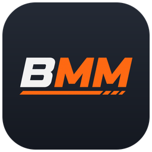
</p>

<h1 align="center">Beam Mod Manager</h1>

<p align="center">
  The free mod manager for <b>BeamNG.drive®</b> and <b>BeamMP</b> on Windows.<br>
  Every mod in one library, Loadouts in one click, BeamMP servers in one click, duplicates cleaned up.
</p>

<p align="center">
  <a href="../../releases/latest"></a>
  
  
  <a href="https://discord.gg/dR43TEaQ4f"></a>
</p>

<p align="center">
  <a href="#download"><b>Download</b></a> &nbsp;·&nbsp;
  <a href="#verify-your-download"><b>Verify your download</b></a> &nbsp;·&nbsp;
  <a href="https://beammodmanager.com"><b>Website</b></a> &nbsp;·&nbsp;
  <a href="#support-the-project"><b>Support the project</b></a>
</p>

<p align="center">
  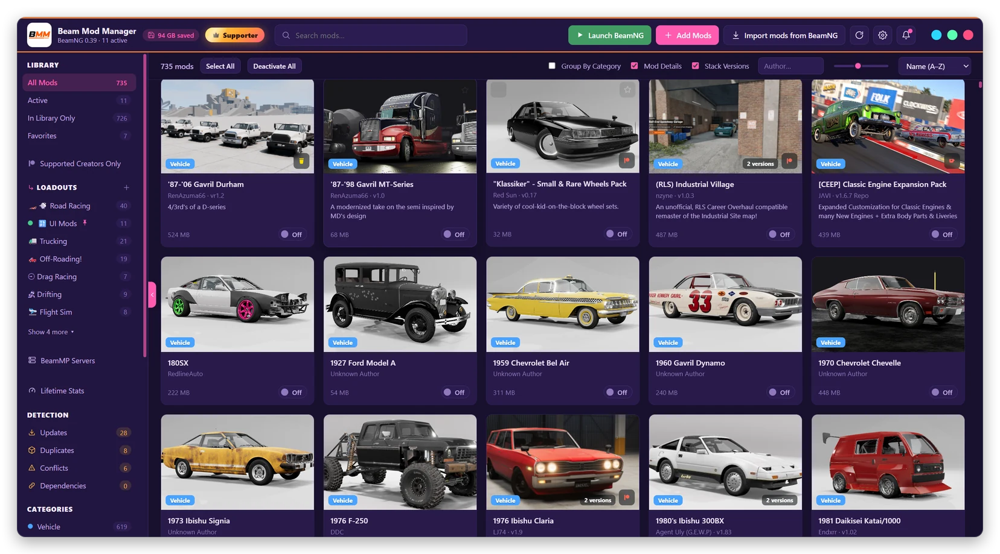
</p>

This repository publishes BMM's **official release artifacts only**: installers, checksums and
verification information. It contains no application source code.

## What it does

- **One library for every mod.** Your mods live in one searchable library outside the game, with no size
  limit. Tags, favorites, filters and custom cover images keep thousands of mods findable.
- **Instant on and off.** Mods switch on and off with hardlinks: no copying, no second copy on disk, no waiting.
- **Loadouts.** Named sets of mods you swap in one click: one for racing, one for off-roading, one for BeamMP.
  Share any Loadout as a link that opens straight in BMM.
- **BeamMP servers.** Browse servers, see which of a server’s mods you already have, and prep them in one click.
- **Duplicates and old versions, cleaned up.** BMM finds identical copies and outdated versions and removes
  them for you, with a 7-day undo.
- **Update checks.** Know when a mod has a newer version.
- **Driving stats.** Last-session and lifetime numbers: distance, top speed, 0–60 times and more, plus a
  "your year in BeamNG" image you can share.
- **Drag and drop, or just play.** Drop mods onto the window, or let BMM import new ones when the game closes.
- **Mod files never leave your PC.**

Optional Patreon tiers add extras. **Player** ($3/month): unlimited Loadouts, one-click mod updates,
Always On Loadouts, dependency check, conflict detection, the Live Dashboard with real-time gauges and 7
premium themes. **Supporter** ($9/month): everything in Player plus Update All and the Supporter-only BMM
BeamMP server. The free version has no time limit and no ads.

## A quick tour

### Loadouts

<p align="center">
  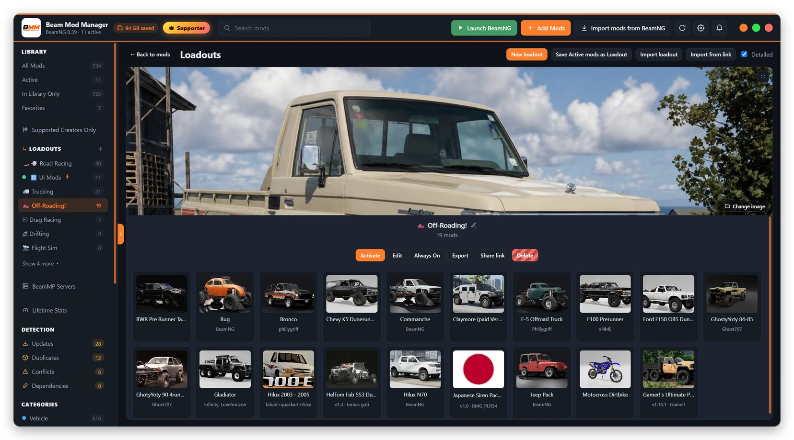
</p>

Group mods into Loadouts and switch between them in one click. Give each one a cover image, and share a
Loadout with friends as a link.

### BeamMP servers

<p align="center">
  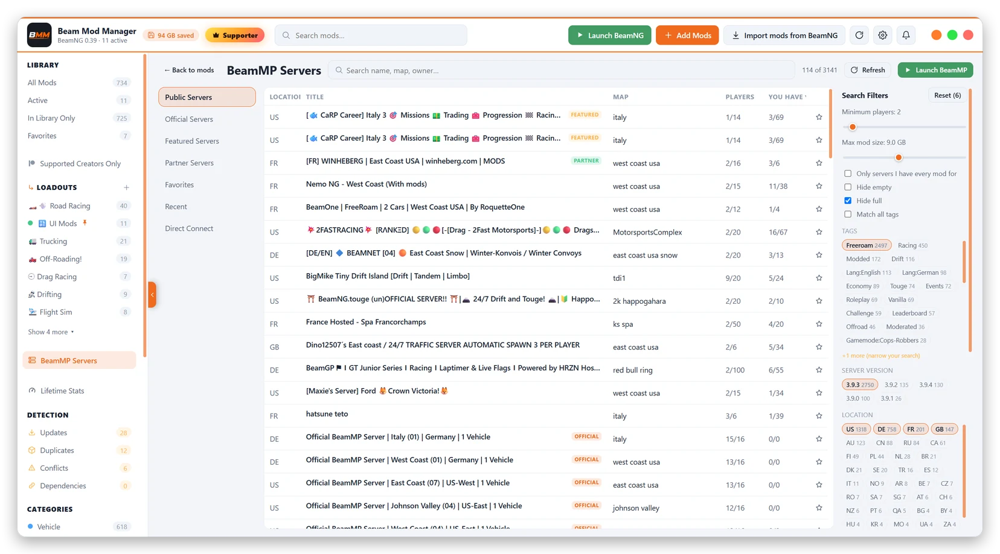
</p>

Every public BeamMP server, with filters for players, tags, location and mod size. BMM shows which of a
server’s mods you already have and preps them in one click, so your own mods folder stays clean.

### Duplicates and old versions

<p align="center">
  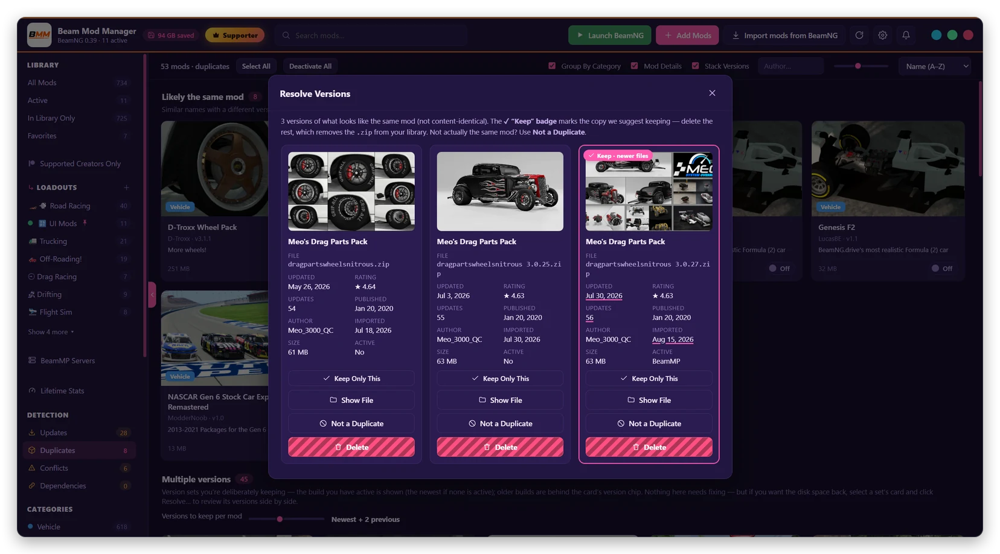
</p>

Three copies of the same pack? BMM shows them side by side, suggests which one to keep, and removes the
rest when you say so.

### Driving stats

<p align="center">
  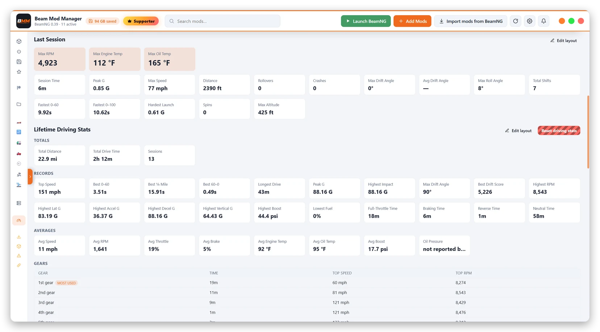
</p>

Last session and lifetime: distance, top speed, best 0–60, peak G, favorite map and more. Turn them into
an image to share.

## Download

Get the latest version from **[Releases](../../releases/latest)** or from
**[beammodmanager.com](https://beammodmanager.com)**. Each release has two builds:

| File | What it is |
| --- | --- |
| `Beam-Mod-Manager-<version>-Setup.exe` | **The installer (recommended).** Start Menu and desktop shortcuts, and BMM updates itself in one click |
| `Beam-Mod-Manager-<version>-Portable.exe` | **Portable.** One file, no installation. Run it from anywhere |

**Requirements:** Windows 10 or 11 (64-bit) and BeamNG.drive. Keeping the BMM library on the same drive as
BeamNG is recommended so mods can switch instantly with hardlinks; other drives work too, using copies.

What's new in each release: the [changelog](https://beammodmanager.com/#changelog), and the notes on each
[release](../../releases).

### Official downloads

There are exactly two official sources for BMM installers:

- **[beammodmanager.com](https://beammodmanager.com)**: the website
- **This repository's [Releases](../../releases)** page

Anywhere else offering a BMM download (a third-party mirror, a forum attachment, a look-alike
GitHub repository, a mod-piracy site) is unofficial and not something we can vouch for. If in
doubt, download from one of the two sources above and verify the hash yourself using the steps
below.

## Verify your download

Every release includes a `SHA256SUMS.txt` listing the SHA-256 hash of each installer. To check
that the file you downloaded matches what we published:

```powershell
Get-FileHash .\Beam-Mod-Manager-<version>-Setup.exe -Algorithm SHA256
```

Compare the resulting hash against the matching line in that release's `SHA256SUMS.txt`, and
against the value published on **[beammodmanager.com/security](https://beammodmanager.com/security/)**.
If they don't match exactly, don't run the installer. Re-download it from an official source above
and verify again.

Each release also links a **VirusTotal** analysis for every artifact. That link is a supporting
signal: it shows how a broad set of antivirus engines currently scores the exact file we
published. It is not a guarantee of safety. Always verify the SHA-256 hash first; VirusTotal is a
second, independent check on top of that, not a replacement for it.

### Code signing

Since 0.8.47, releases are **digitally signed** by the developer (publisher name
**NickTheGrizzly**) with an identity-verified certificate issued by Microsoft. To inspect it:
right-click the installer → **Properties** → **Digital Signatures**.

Windows SmartScreen may still show a warning for a while. It fades as more people install signed
versions, so it won't vanish overnight. That warning is about reputation, not about the file being
altered. The SHA-256 check above is how you confirm the file is exactly what we published.

## Help, news and community

| Looking for | Go to |
| --- | --- |
| Features, FAQ and guides | [beammodmanager.com](https://beammodmanager.com) · [FAQ](https://beammodmanager.com/faq/) |
| Changelog and devlog | [beammodmanager.com/blog](https://beammodmanager.com/blog/) |
| Chat, help and feedback | [Discord](https://discord.gg/dR43TEaQ4f) |
| A security issue | [SECURITY.md](SECURITY.md) |

## Support the project

<picture>
  <source media="(prefers-color-scheme: dark)" srcset="docs/support/banner-dark.svg">
  <source media="(prefers-color-scheme: light)" srcset="docs/support/banner-light.svg">
  
</picture>

Beam Mod Manager is made by one independent developer, is free to use, and has no ads. If it saved you
some time or some disk space, a tip helps it keep growing: more features, quicker fixes and support for
every new BeamNG update. Thank you! Telling a friend, or a bug report on
[Discord](https://discord.gg/dR43TEaQ4f), helps just as much.

<p align="center">
  <a href="https://www.patreon.com/cw/BeamModManager"></a>&nbsp;
  <a href="https://ko-fi.com/beammodmanager"></a>&nbsp;
  <a href="https://buymeacoffee.com/beammodmanager"></a>
</p>

Patreon memberships also unlock the [Player and Supporter](https://beammodmanager.com/#supporter) extras in the app.

### Crypto

Scan a code with your wallet, or copy an address with the button in the corner of its box.

> [!IMPORTANT]
> Send each coin only over the network named next to its address. Coins sent over another network may be lost.

<table>
  <tr>
    <td align="center" width="196">
      
    </td>
    <td>
      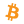&nbsp;
      <b>Bitcoin</b>
      <br><sub>BTC · native SegWit (bech32) address</sub>

```text
bc1qw6sep5lft6e3ed2x5kx797jdrl5yqqe7kzhjhe
```

</td>
  </tr>
  <tr>
    <td align="center" width="196">
      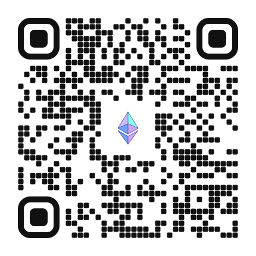
    </td>
    <td>
      
      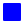
      
      &nbsp;
      <b>Ethereum · Base · BNB Chain · Arbitrum</b>
      <br><sub>One address on all four networks · ETH, BNB, USDT, USDC and other tokens</sub>

```text
0x682e8fBE95E6c4Ff45Fceca203dB516d9c7e936e
```

</td>
  </tr>
  <tr>
    <td align="center" width="196">
      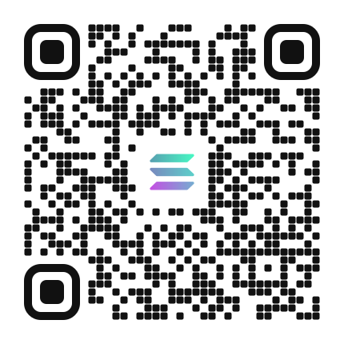
    </td>
    <td>
      &nbsp;
      <b>Solana</b>
      <br><sub>SOL, USDC and USDT (SPL tokens)</sub>

```text
DczNdhbYgoHPR4juVPF5G8YccY7kNSw8gtbgRH6N5wJ1
```

</td>
  </tr>
  <tr>
    <td align="center" width="196">
      
    </td>
    <td>
      &nbsp;
      <b>TON</b>
      <br><sub>Toncoin and USDT on TON · no memo needed</sub>

```text
UQBSwmD4q7L265jXTICl6X9UV-qX21-7dMXHR1g96jbGjnWd
```

</td>
  </tr>
</table>

## Acknowledgements and trademarks

The network logos under [Support the project](#support-the-project) are from
[Web3 Icons](https://github.com/0xa3k5/web3icons) (MIT), and the Patreon, Ko-fi and Buy Me a Coffee logos from
[Simple Icons](https://simpleicons.org) (CC0).

BeamNG.drive® is a registered trademark of BeamNG GmbH. Beam Mod Manager is not affiliated with
BeamNG GmbH or the BeamMP team.
